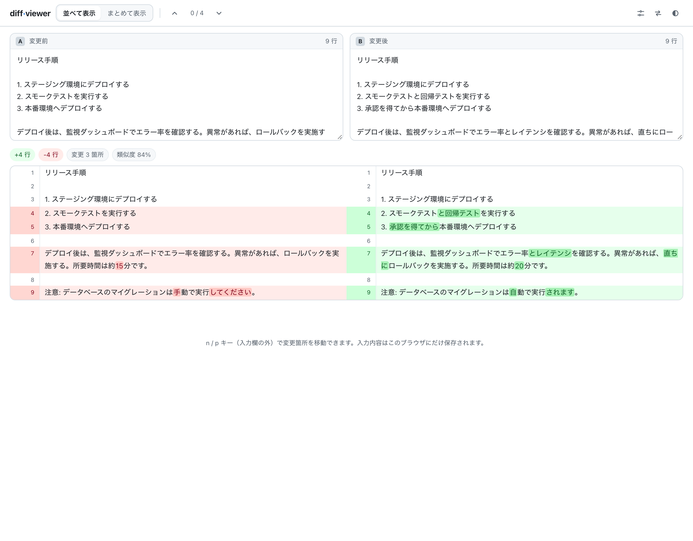

# text-diff-viewer

2 つのテキストの差分を単語単位で表示する HTML ツールです。

**デモ**：https://fairy26.github.io/text-diff-viewer/

## 使い方

1. 左右の入力欄にテキストを貼り付けます。
2. 「並べて表示」と「まとめて表示」を切り替えます。
3. 表示設定ボタンで、文字単位まで精密化、空白の違いを無視、大文字小文字を無視、コンテキスト行数を変えます。
4. `n` / `p` キー（入力欄の外）で変更箇所へ移動します。

入力内容はブラウザの localStorage に保存されます。ローカルで使う場合は `index.html` をブラウザで開いてください。
